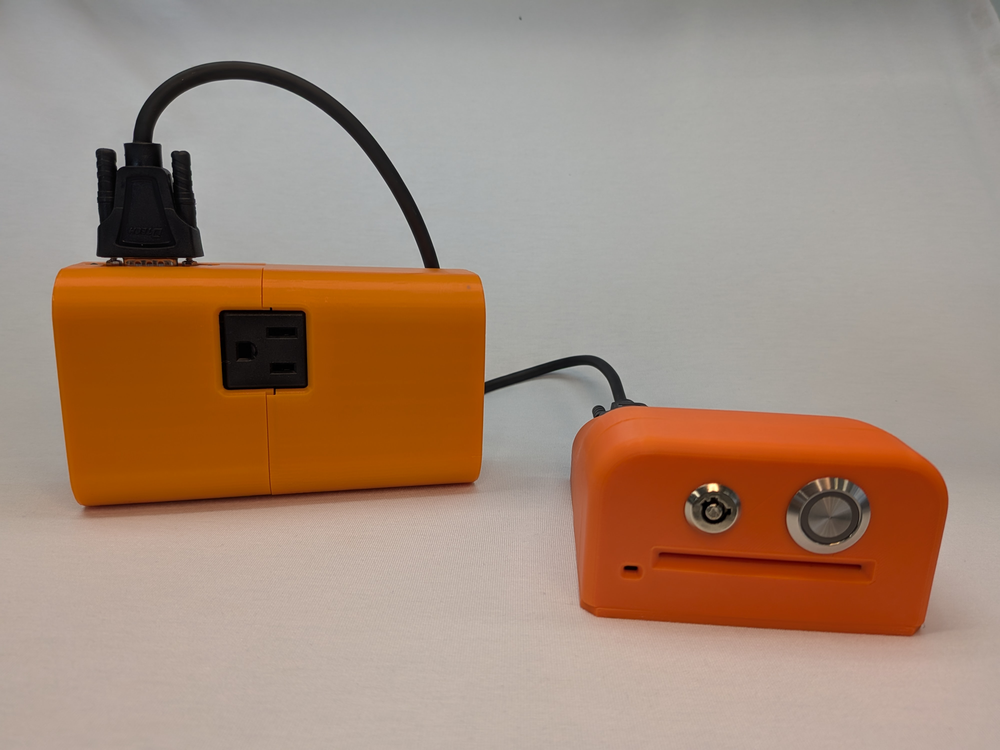
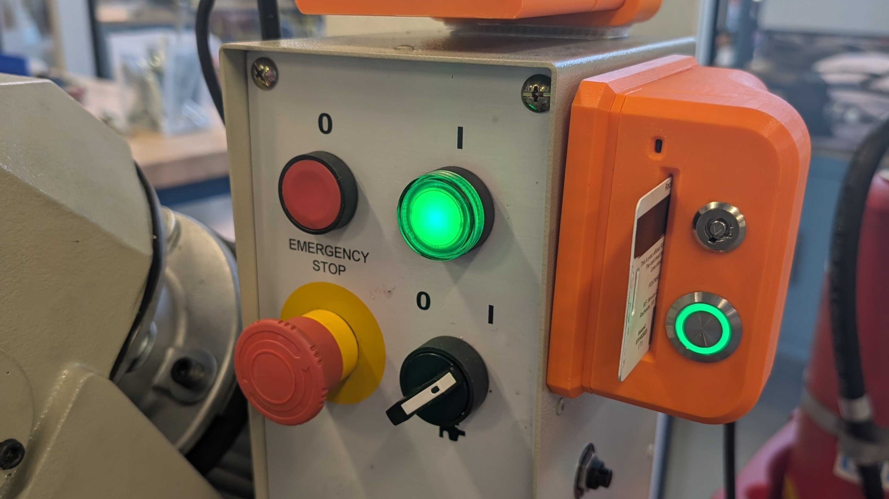

# 2. Hardware Features

## Hardware Overview

The MakeACS hardware is what enables the system to control machine-level access, track usage of the shops, and automatically generate maintenance tasks based on usage. 

MakeACS hardware is a modular, shared-bus system; multiple individual components can be interconnected to tailor the hardware to the application at hand. By combining different card readers, switches, and accessories, thousands of possible setups can be achieved.

Components are connected with a simple HD15 cable, no need for any specialized tooling or proprietary cables. All components in a MakeACS deployment are also constantly monitored and inventoried, so that a malicious actor cannot swap components around to gain access to equipment they otherwise should not be able to.

When installing, each component is self-contained and in most cases does not require any specialized training or skills to integrate with the equipment. Any configuration that is needed can be done through a graphical user interface on any Windows computer.

/// caption
An AC Power Switch and a Core are the most common deployment.
///

## The Core

The Core is the heart of a MakeACS deployment. It is where the end-user interacts with the system, and is how the deployment communicates with the server. 

All Cores are equipped with both a 2.4GHz Wi-Fi radio and a 100Mbps Ethernet connection to communicate with the server. All traffic to and from the Core is 100% encrypted, so it can be put onto your facility's main network without security concerns. In the event of a network outage, the Core can operate off of internal offline lists of approved users for up to a month.

User identification in MakeACS is designed around repurposing already-issued ID cards, such as student IDs or membership cards. This means fewer things for your users to have to remember when they come in to make. Supported cards include:

* **NFC** (13.56MHz), ISO/IEC 14443A, MIFARE (Classic, Ultralight, Ultralight C, Plus, DESFire), NTAG
    * Can identify by ISO UID or by decrypting secure application data (such as a student ID number)
    * Hardware supports smartphone- or smartwatch-based NFC identification as well.
* **RFID** (125KHz), FSK (HID and HID-compatible, up to 39 bytes), ASK (EM Microelectronic and compatible)
    * Can be configured to use unique card number or facility code + card number for user identification

Once a user has been identified and the server authorizes them to use the equipment, the session is kept alive in one of two configurable ways;

* **Tap**: Works like a traditional access control card reader, tapping the ID card will start a session of a pre-set length. Tapping again refreshes the countdown.
* **Insert**: Requires the card to remain inserted into the MakeACS Core to continue a session duration indefinitely, ensuring constant operator presence.

/// caption
Removing your ID would immediately shut off this cold saw.
///

The Core has a basic RGB LED and buzzer for communicating state, but also has an open-ended connection interface to allow for a display module. This is ideal for more complex systems, or for readers using the **Tap** mode, since it can show remaining time.

///caption
Tap you ID to activate the paint booth. The display will show you how long you have remaining in your session. 
///

The Core can also be used as a sign-in reader to a space. This is useful for collecting statistics of the number of people who enter the space and when, and can also be used to enforce users checking in at the front desk before using equipment for the day.

///caption
If you do not sign in for the day, equipment will not unlock for you!
///

## The Switch

The Switch is the part of the access control hardware that actually controls access. There are a number of switches developed for MakeACS, with different strategies for integrating with a wide variety of equipment. Multiple switches can also be used together, to form more complex access control setups all from a single card reader.

In most cases, the switch is also where the MakeACS deployment harvests power from, so there is usually no need for an additional power cable or connection. This allows the deployment to be mounted wherever is best for accessability and ergonomics, with no need to worry about proximity to an outlet.

### AC Power Switch

The AC Power Switch is by far the most popular MakeACS switch. It simply goes inline between the outlet on the wall and your equipment's power cable. There is no need for any invasive in-machine wiring or doing your own AC connections. 

The AC Power Switch is rated for highly inductive loads, and can handle a sustained 20 amps of current. This makes it suitable for anything from a sewing machine to a bandsaw.

The switch will monitor for any faults such as over-temperature or blown fuses, and can automatically restrict access and notify staff. The AC Power Switch can also be configured to not allow a machine to be activated if it is detected to be in the "on" state, to prevent unexpected startups. Conversely, the AC Power Switch can be configured to give a warning if a session ends while equipment is detected to still be in use, so the user has a chance to restart the session and prevent issues.  

To prevent bypassing or tampering, the AC Power Switch has an optional plug lock, to secure the equipment's plug in place.

///caption
The AC Power Switch, mounted to the base of a drill press.
///

### USB Hub Switch

For a lot of complex equipment, the easiest way to control access to it is by locking down its computer. This strategy works great on laser cutters, water jets, and CNC machines. For this, the USB Hub Switch is a great fit. The switch will activate or de-activate 4 downstream USB ports for keyboards, mice, USB drives, etc.

The USB Hub Switch has a 5th downstream USB port that is connected when the switch is off, which can be used to automatically execute a cleanup script. For instance at RIT, when a user removes their ID card from a laser cutter's computer, it will go through and force-close all windows, make sure the user is logged out of any accounts, etc., before restarting the laser cutter software to give a blank slate to the next user. 

### Relay Switch

For applications that require more direct integration with equipment, the Relay Switch is the best choice. The relay switch provides galvanically isolated dry contacts, that can be integrated with any arbitrary power or signal to control a piece of equipment. Common examples include interrupting an interlock or e-stop loop, or switching a larger purpose-installed contactor for very large loads like a welding station. 

There are 3 variants of the Relay Switch in MakeACS:

1. The Signal Relay Switch has special gold-plated contacts, allowing it to work with small digital signals, like those from a microcontroller. It has 2 sets of NC and NO contacts, so you can switch multiple signals in parallel. Each contact pair can handle up to 0.5A at 125V. 

2. The DIN Relay Switch is rated for 250V at 5A, for integration with larger electrical cabinets. It is usually used to drive a larger contactor for high-current or high-voltage loads, such as a welding station or large woodworking equipment.

3. The DIN Controller is similar to the DIN Relay Switch, but with 5 independent channels. This allows you more control over how a system is controlled. For example at RIT, this switch is used on the paint booth: the lights, fan, and heater are on 3 separate channels, so anyone can turn on the fan and lights, but only those who are authorized can turn on the burner. 

## Other Components

Beyond simply controlling access, MakeACS supports additional accessories in a deployment, to further augment the capabilities. Here are some examples of these;

### Temperature Monitor

The temperature monitor allows an arbitrary temperature probe to be attached to a deployment, that can be used to lock out access if a temperature gets too cold or too hot. 

At RIT, this is used to ensure the paint booth is not drawing in too much cold outside air, chilling the entire makerspace. 

### Indicator Light

To help users see equipment availability, this add-on allows the attachment of a standard Andon light tower, which can show deployment state. 

### Laser Fume Monitor

This add-on integrates with the Epilog Laser fume extractor control interface, and will monitor for and report any faults related to the filters or the air assist supply line. If either is found to be malfunctioning, the equipment is locked out automatically.

///caption
The fume extractor failed to start, so the system is put into lockout.
///

### Hobbs Timer

While MakeACS automatically tracks usage time based on the total time on, this add-on allows for a specific signal to be used for hours tracking. This is useful on something like a CNC, where maintenance tasks should be based on spindle run-time, versus machine on-time.

### Buddy System Enforcer

This add-on lets two Cores control one deployment, in one of three modes. This enables hardware-enforcement of the buddy policy on high-risk equipment, or more complex user authorization setups.

* AND Mode: Both Cores need an approved user present to activate the equipment. This ensures 2 trained users are present at all times. The training requirements for each of the Cores can be different as well, to ensure a specially-trained staff member is present, for instance.

* OR Mode: Either Core needs an approved user to activate the equipment. This allows trained users to hand off equipment without disrupting its operation.

* AND-OR Mode: Both Cores need an approved user to activate, but then either one can keep it online. This is useful on equipment where you want staff to check over things before the user starts running, but once it is approved they can work on their own.

### Blast Gate Controller

This add-on enables MakeACS to open blast gates based on what equipment is in use. This ensures maximum suction to where it is needed, and prevents excessive wear on the vacuum system when nothing is in use. It is designed for use with iVac automated blast gates, but can work with any generic 12v blast gate system.

## Deployment Examples

Below are some examples of how MakeACS is deployed at RIT.

### AC Power Switch

The AC Power Switch is by far the most common switch. RIT uses it on the following machines, to name a few;

* Bernina 475, 590, E16, L460, Q20
* Weller soldering iron
* Metcal soldering heat gun
* Roland RS-24 Vinyl Cutter
* Bantam CNC mill
* Laguna bandsaw, belt sander, drum sander, jointer
* Powermatic drill press
* Jet bandsaw, edge sander
* Generic panel saw
* Generic rotary grinding/sanding tool

### Relay Switch

#### Haas CNC Machines

All Haas CNC machines produced after 2014 ship with an NGC (Next Generation Controller). This controller has a dedicated auxiliary E-stop plug, intended for connecting a robot or other automation system. This connection can instead be connected to a **Relay Switch**. 

Power for the system can come from the spare 110V outlets found inside most Haas electrical cabinets. 

///caption
Source: [HaasCNC.com](https://haascnc.com/service/troubleshooting-and-how-to/reference-documents/robot-integration-aid---ngc.html)
///

#### Fablight Laser Cutter

The Fablight Laser Cutter has an spare interlock loop in an access panel on the left side of the machine, intended for use with a tube-extension add-on. A **Relay Switch** interrupting this connection is read as a door-open fault, and the machine will not move or fire the laser until a card is present.

Power for the system can come from open USB ports inside the electrical cabinet. 

#### ProtoTrak Mill

KMX-controller ProtoTrak machines have an auxiliary E-stop plug in the back of the machine, labeled "EURO E-STOP". By default, it ships with a jumper head on it that connects pins 1-6, 2-4, 3-5, and 7-8-9. Interrupting the 2-4 connection with a **Relay Switch** puts the controller in an emergency lockout state, making the machine inoperable but without losing any of the parameters saved in the controller.

On KMX machines with a power knee, RIT also installs an **AC Power Switch**, so that the knee's power is cut when a card is not present.

### USB Hub Switch

#### Epilog Laser Cutter

Epilog lasers can take up to a minute to start up, so cutting their power is not ideal. Instead, at RIT access control restricts use of the computer used to send jobs to the laser, by interrupting their keyboard, mouse, and exposed USB ports with a **USB Hub Switch**. 

This has the added benefit of running an automatic cleanup script when a user is done with the computer, ensuring all their work is closed and all accounts are logged out, so every user has a clean-slate experience.

#### OMAX Waterjet

OMAX waterjets are intended to be constantly connected to an operator computer. By interrupting the computer's keyboard and mouse with a **USB Hub Switch**, the user cannot activate the pump or start a cut. The benefit of this is that it does not interfere with any critical interfaces, such as the E-stop or feed hold buttons, meaning they are always readily available in the event of an emergency.

#### Generic Lab Computers

For lab computers with software or licenses that do not play well with individual user accounts, a **USB Hub Switch** controlling access to a computer can help keep a record of users, and reset the computer to a known state after each use, with the help of software like Deep Freeze.

## Hardware API

MakeACS hardware communicates with the MakeACS server via a standardized MQTT API. This API structure can be adopted by other systems, to allow MakeACS hardware to be used with your own system. See the [MakeACS Hardware Standards](https://makeacs.github.io/HW-Standards/) for more information.