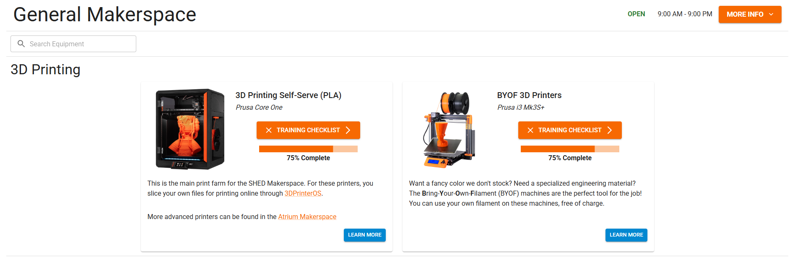
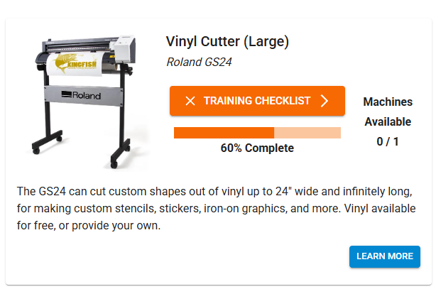
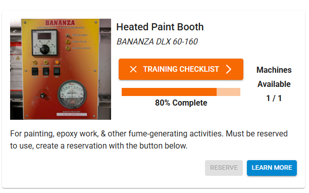

# 2. Website

The MakeACS website is the public face of your shop! Users can come here to learn more about equipment, take [trainings](./3-training.md), and see important information like hours and equipment availability. For staff, it is the main control interface and how all [shop management](./5-shop-management.md) resources are accessed. 

///caption
The MakeACS homepage at the RIT SHED Makerspaces
///

## Public Information

The website is visible to users even before they log in, with lots of useful information;

* Facility hours, with support for special-case hours and differing hours for different areas.
* Announcements with an integrated call-to-action link.
* Facility information such as locations, links to maps, etc.
* General machine information, and links to manuals, guides, etc.
* Real-time equipment availability, to see if what you are looking to use is free.
* A publicly-available REST API for getting the hours, announcements, etc. for integration into other systems and websites.
* Upcoming events, pulled via API from systems like Eventbrite.

Additionally, the website generates and serves pages for the hours, announcements, and events that can be constantly displayed on screens around the facility. These screens will automatically update as changes are made to the website, and handle anti-burn in image shifting. They are designed to be extremely easy to display, so a cheap Raspberry Pi Zero connected to the back of the TV can handle it.

/// caption
Check it out yourself; [make.rit.edu/app/display/hours/36](https://make.rit.edu/app/display/hours/36)
///

/// caption
Upcoming Events, Hours, and Announcements Displays
///

## Logging In (SSO)

MakeACS supports user login via SSO, implementing Shibboleth SAML 2.0. This allows users to log in with already-existing university or institution credentials, and also means MakeACS does not have access to any sensitive information, such as passwords.

When a user logs in, SSO information is automatically pulled and updated on the user's MakeACS account. By default, this includes their first and last names, institution username/email, and preferred pronouns. MakeACS can be configured to gather more information based on SAML attributes, such as a user's role in the institution (student, staff, alumni, etc.), home department, graduation year, etc., for use in [statistics](./6-statistics-logging.md). 

Additionally, user accounts can be restricted based on SSO attributes. For example, RIT does not permit alumni to use the makerspaces, but they still retain an RIT SSO account. If an alumni signs in to MakeACS, their account is flagged and put in an archived state, so they can no longer access equipment. See [user restrictions](./5-shop-management.md#user-restrictions) for more information.

A user's preferred name and pronouns are readily accessible by staff, so they can properly address users.

/// caption
User info visible to staff, pulled from SSO
///

## Equipment Information

The MakeACS website's primary purpose is to help users find information about equipment. Equipment can represent just about anything in a facility - discrete equipment, general tooling, or services. To help logically organize equipment, the entire MakeACS facility can be split into top-level *makerspaces*, each of which can contain multiple *rooms*, that each then contain equipment. 

There is no limit on the number of makerspaces, rooms, or equipments in a MakeACS website. For very large facilities, there is a search bar in each makerspace to help filter down options.

///caption
The "General Makerspace" contains a room called "3D Printing", with 2 different equipments.
///

Each piece of equipment gets a *card*, that contains the name of the equipment, a brief (markdown-supported) description of its use, an image, a link to the [training checklist](./3-training.md), and a link to further information, such as a manual or docs page. If fitted with [access control hardware](./4-access-control.md), the real-time availability of equipment will be displayed as well. 

/// caption
Looks like the vinyl cutter is already in use!
///

!!! tip
    There can be multiple *instances* of a piece of equipment, which all share the same training requirements. This is a useful way to group, for instance, 3 laser cutters under one "Laser Cutter" equipment card and training checklist.

## Reservations

MakeACS equipment, by default, is first-come, first-serve. For specialized, long-duration, or in-demand equipment, MakeACS implements a reservation system. Equipment can be designated as self-reservable, where any trained user can book an appointment, or staff-reservable, where users can see the availability on a calendar, but need to work with staff to reserve it. 

///caption
My trainings are not done, so the "RESERVE" button is greyed out.
///

Reservation data is anonymous; users cannot see who else has a reservation, just that a date is unavailable. Restrictions can be placed on when a user can make a reservation, and how far in advance it must be scheduled. 

Reservations must be approved or denied by staff. To help staff manage reservations, an automated Slack message or email can be sent on a new reservation request.

## Customization

The MakeACS website is fully customizable without the need for any programming skills! Custom themes can be designed in a graphical editor, which can either be enforced on all users, or provided as an option. This enables a dark/light mode, seasonal overlays, and small easter eggs! Even the website's logo and name can be changed as part of a theme. 

!!!tip
    Images with a transparent background are automatically given a white background in any dark theme, so the subject of the image is still clearly visible.

///caption
Dark mode is a very popular theme that many users opt for. 
///

MakeACS also incorporates a link shortener and QR code generator, allowing the creation of shortened URLs based on the MakeACS website URL. This creates a better user experience with easier-to-type URLs, and a sense of familiarity using the same URL as the rest of the shop's resources. As an example, RIT uses 

> *make.rit.edu/link/policies* 

to direct users to makerspace policies, instead of the much harder to type

> *docs.make.rit.edu/%E2%80%8BPolicies%20%26%20Guidances/Makerspace%20Policies/*